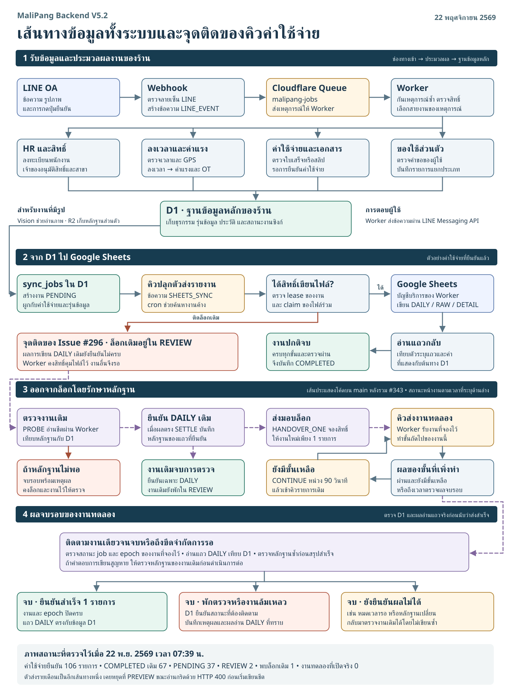

# แผนผังระบบ MaliPang

ทุก Issue และงานใหม่ให้อ่านภาพรวมและส่วนที่เกี่ยวข้องก่อนเริ่มวิเคราะห์ วางแผน หรือแก้ไข

[เปิดแผนผังฉบับอ่าน 7 หน้า (PDF)](system-map.pdf) · [ต้นฉบับรายละเอียดที่แก้ไขได้ (HTML)](system-map.html)

| หน้า | ใช้ตอบคำถาม |
| --- | --- |
| 1 | เหตุการณ์จาก LINE ไปถึงรายงานร้านผ่านระบบใดบ้าง |
| 2 | งานพนักงาน ลงเวลา ค่าแรง ค่าใช้จ่าย และของใช้ส่วนตัว ใช้ข้อมูลอะไร |
| 3 | ค่าใช้จ่ายที่ยืนยันแล้วเข้าสู่คิวและถูกตรวจใน Google Sheets อย่างไร |
| 4 | ล็อกเดิมขวางงานใด และตัวเลขที่ตรวจได้ ณ เวลานั้นหมายถึงอะไร |
| 5 | หลักฐานใดปิดการตรวจ DAILY ของงานเดิม และส่วนใดยังอยู่ใน REVIEW |
| 6 | เมื่อส่งมอบสิทธิ์ให้งานทดลองหนึ่งรายการ จะติดตามต่อและจบรอบอย่างไร |
| 7 | ใช้ไฟล์โค้ดและหลักฐานใดตรวจพฤติกรรมแต่ละส่วน |

## ที่มาของข้อมูล

ตรวจเส้นทางคิวกับโค้ดบน `main` ที่ `5bf347f` ซึ่งรวม #342 และ #343 แล้ว เมื่อรอบติดตามหมดเวลา ผู้ดูแลใช้ `FINISH_PILOT` อ่านผลของงานเดิมต่อได้ การนับว่าสำเร็จต้องตรวจทั้งสถานะงาน รอบการเขียน และค่า DAILY ที่อ่านกลับจากชีตเทียบ D1 ดู [ตัวรัน](../../scripts/prod-normal-queue-pilot.mjs) และ [ขั้นตอนคิวปกติ](../ISSUE296_NORMAL_QUEUE_PILOT_TH.md)

ตัวเลขหน้างานหน้า 4 เป็นผลตรวจย้อนหลังวันที่ 22 พฤศจิกายน 2569 เวลา 07:39 น. ตามเวลาไทย เมื่อต้องใช้สถานะ Production ปัจจุบัน ให้ตรวจแหล่งจริงและระบุเวลาตรวจใหม่

## เมื่อ flow เปลี่ยน

ผู้ทำงานแก้ภาพรวม SVG และส่วนที่ได้รับผลใน HTML ให้ตรงกับโค้ดใน PR เดียวกัน พร้อมปรับเส้นทางสำเร็จ พัก ลองใหม่ และผลจบตามที่เปลี่ยน ส่งออก PDF จาก HTML ด้วยคำสั่งพิมพ์ของเบราว์เซอร์ เปิดการพิมพ์พื้นหลัง ปิดหัวและท้ายกระดาษ และตรวจว่าครบ 7 หน้าหรือตรงกับสารบัญที่แก้แล้ว หากแจกภาพหรือ ZIP ให้สร้างใหม่จากต้นฉบับรุ่นเดียวกัน ผู้ทบทวนเทียบแผนผังกับโค้ดและผลทดสอบก่อนปิดงาน
