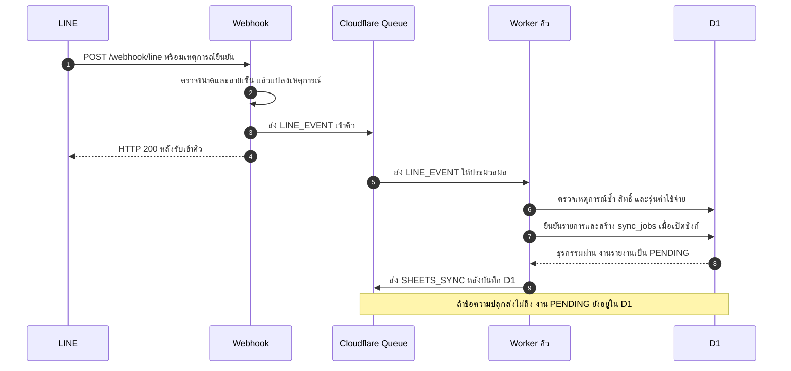
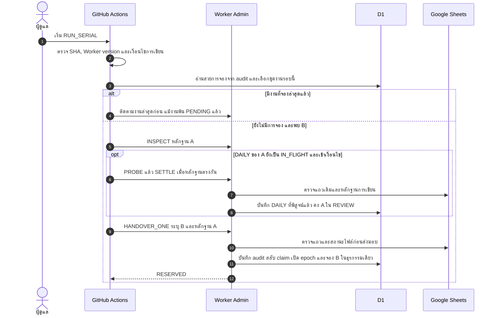
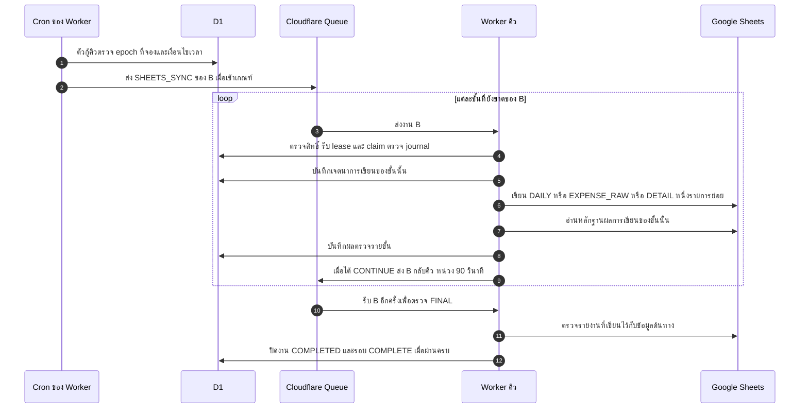
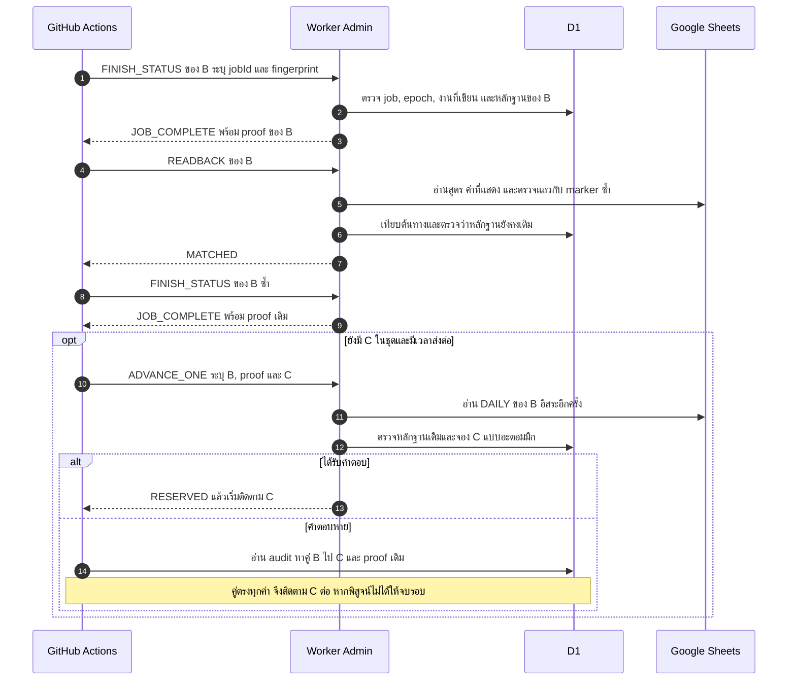
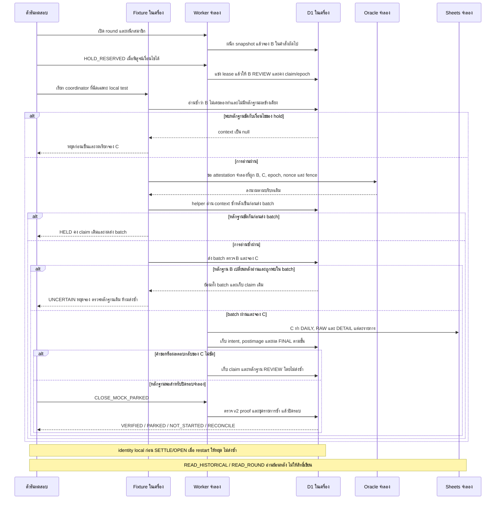

# ลำดับการส่งค่าใช้จ่ายจาก D1 ไป Google Sheets

ใช้รับช่วงงาน #296 และ #348 ใน PR #349 อ้างอิงโค้ด `5a72db3` อ่านจากบนลงล่าง ลูกศรทึบคือการเรียกหรือส่งงาน ลูกศรประคือผลที่ตอบกลับ **A** คือรายการเดิมที่พัก **B** คือรายการแรกที่ได้รับสิทธิ์ และ **C** คือรายการถัดไป ทั้งสามเป็นชื่อสมมติ ภาพอธิบายโค้ดใน PR ส่วนสถานะคิวและจำนวนที่ส่งบน Production ต้องตรวจแยกตามเวลาจริง

[เปิดฉบับ PDF](serial-sequence.pdf) · [ภาพรวมระบบ](README.md) · [คู่มือ UAT และการใช้งาน](../ISSUE296_NORMAL_QUEUE_PILOT_TH.md)

## 1. จากการกดยืนยันใน LINE ถึงงานรอใน D1

HTTP 200 ยืนยันว่า webhook รับเหตุการณ์แล้ว ส่วนยอดที่ร้านยืนยันดูจาก `expense_events` และรุ่นข้อมูลใน D1 เมื่อมี claim ของไฟล์อยู่ใน `REVIEW` ตัวกู้คิวงดส่งงาน ส่วนข้อความที่ถึง Worker แล้วอาจจบด้วย `BLOCKED` และ ACK โดยงานรอยังอยู่ใน D1. [Webhook](../../src/webhook/handler.ts) · [ยืนยันและสร้างงาน](../../src/expense/confirm.ts) · [ปลุกคิวหลังบันทึก](../../src/expense/service.ts) · [ตัวกู้คิว](../../src/db/repositories.ts)

## 2. เลือกชุดงาน พิสูจน์ A และจอง B

ก่อนเริ่ม RUN_SERIAL ตัวรันตรวจผล backup/restore ของ SHA ที่ระบุ การกันผู้เขียนอื่น และการเฝ้าดูของเจ้าของ รวมถึงตรวจว่า Worker รุ่นที่ระบุรับ traffic ทั้งหมด ตัวรันเลือกงานยืนยันรุ่น 1 ของเดือนปัจจุบันตามเวลาไทย หลัง cutover ซึ่งถึงเวลาทำและยังไม่เคยลองส่ง งานที่เข้ามาหลังเลือกชุดจะรอรอบถัดไป ถ้าไม่มีงานให้ติดตามและไม่มีผู้สมัคร ตัวรันจบที่ศูนย์ หาก DAILY ของ A ยืนยันไว้แล้ว จะใช้หลักฐานนั้นเข้าสู่ขั้นจองโดยตรง ถ้าหลักฐานไม่พอ ตัวรันหยุดก่อนจอง B. [ตัวเลือกงานและขั้น SETTLE](../../scripts/prod-normal-queue-pilot.mjs) · [การส่งมอบล็อก](../../src/admin/parked-expense-handover.ts)

## 3. งาน B ถูกเขียนและตรวจทีละขั้น

ตัวส่งกับตัวติดตามในภาพที่ 4 ทำงานคู่ขนานหลังการจอง คิวทำทีละขั้นตามลำดับ DAILY → EXPENSE_RAW → DETAIL ตามจำนวนรายการย่อย → FINAL ระยะ 90 วินาทีใช้กับ `CONTINUE` ส่วน `BUSY` ใช้เวลารอตามเงื่อนไข ถ้าผลเขียนคลุมเครือให้เก็บ journal เพื่อพิสูจน์ผลเดิม ขั้น FINAL ของตัวส่งและการอ่าน DAILY อิสระของตัวติดตามเป็นคนละการตรวจ. [ตัวส่งรายขั้น](../../src/sheets/stable-expense-job.ts) · [ตัวรับและส่งกลับคิว](../../src/index.ts) · [การตรวจแถวรายวัน](../../src/sheets/insert-daily-writer.ts)

## 4. ตรวจ B จากชีตจริงก่อนส่งสิทธิ์ให้ C

โหมดเดิมตรวจ `FINISH_STATUS` ได้สูงสุด 15 ครั้ง ห่างกันครั้งละหนึ่งนาที; โหมดรอบทดลองใช้ progress ของชุดหลักฐานต่อเวลารอเมื่อมีความคืบหน้า โดยมีเพดานเวลารวมและห้ามใช้ progress ให้สิทธิ์เขียน ตัวรันนับ B ว่ายืนยันแล้วหลังอ่าน DAILY ตรงและได้ proof เดิมซ้ำ ส่วนการเลือก C ต้องผ่านการตรวจอีกชั้นที่ Worker ภายในธุรกรรม D1 มีสิทธิ์สร้างการส่งมอบได้เพียงหนึ่งครั้งต่อ B การจอง C ปลุกเส้นทางในภาพที่ 3 เมื่อคิวเข้าเกณฑ์. [ตัวติดตาม](../../scripts/prod-normal-queue-pilot.mjs) · [อ่านแถวแบบระบุงาน](../../src/admin/normal-pilot-readback.ts) · [การจองต่อแบบอะตอมมิก](../../src/admin/serial-expense-handover.ts)

## 5. รับช่วงเมื่อรอบหยุด

| สิ่งที่เห็น | หลักฐานที่ต้องเทียบ | การทำงานต่อ |
| --- | --- | --- |
| คำตอบ SETTLE ของ A หาย | INSPECT ต้องพบ VERIFIED พร้อม fingerprint และ preimage digest เดิม | ตรงจึงไปขั้นจอง B หากต่างให้พัก A พร้อมเหตุผล |
| HANDOVER_ONE ตอบ HELD เพราะ `FINISH_STATUS` อ่านไม่ได้ | claim, epoch, job และ audit ต้องเหมือนก่อนสั่ง | หยุดรอบ ตรวจ schema และรุ่น Worker ก่อนสั่งใหม่ ห้ามจองด้วยวิธีอื่น |
| คำตอบ HANDOVER_ONE หาย | audit การจองแรกต้องมีรายการเดียว ตรงทั้ง jobId ของ B และ fingerprint | ติดตาม B เมื่อพบตรง เก็บสถานะไม่แน่ชัดหากยืนยันไม่ได้ |
| B เป็น JOB_REVIEW หรือ JOB_FAILED | ตัวรันพยายามอ่าน DAILY หนึ่งครั้งและรายงานผลควบคู่กับสถานะงาน | จบรอบก่อนจอง C แม้ DAILY เพียงขั้นเดียวจะตรง |
| B ยัง IN_PROGRESS จนหมดเวลา หรือหลักฐานก่อน/หลังอ่านต่างกัน | ตรวจ job และ epoch ของ B รวมถึงแถว DAILY ของ B | ใช้ FINISH_PILOT ตรวจงานล่าสุดแบบอ่านอย่างเดียว งานในคิวอาจยังทำต่อได้ |
| คำตอบ ADVANCE_ONE หาย | ปลายสายการจองต้องเป็น C และระบุ B, proof และ fingerprint เดิม | คู่ตรงจึงติดตาม C ถ้าขาดหรือต่างให้หยุดและรักษาหลักฐาน |
| FINISH_STATUS เป็น NOT_STARTED หรือ UNVERIFIED | ตรวจ audit, jobId, fingerprint, รุ่น Worker และ epoch ของงานที่เลือก | จบรอบพร้อมเหตุผล ตรวจงานเดิมก่อนส่งต่อ |
| ต้องกลับมาส่งต่อ | RUN_SERIAL อ่าน audit ของสายเดิมและตรวจงานที่จองล่าสุดก่อน รวมถึง Worker version ที่รับช่วง | ถ้าผ่านจึงส่งต่องานในชุดของรอบใหม่ ถ้า Worker เปลี่ยนรุ่นให้ตรวจหลักฐานเพื่อกู้ตามคู่มือ |

**อ่านตัวเลขให้ถูกชุด** จำนวนที่ยืนยันและจำนวนค้างในผล RUN_SERIAL อ้างชุดที่เลือกของการเรียกครั้งนั้น งานที่กลับมาตรวจซ้ำอาจถูกนับว่ายืนยันในรอบใหม่ ยอดค่าใช้จ่ายที่ส่งจริงต้องกระทบยอดตามรหัสและรุ่นของรายการ

**คำที่ใช้ตามเหตุ** `sync_jobs` เก็บสถานะของงาน • `lease` คือสิทธิ์ทำงานชั่วคราวเฉพาะงาน • `claim` คือสิทธิ์เขียนไฟล์ร่วม • `epoch` คือรอบที่อนุญาตเป้าหมาย • `fingerprint` ผูกสายกับหลักฐานของ A • `proof` ผูกผลจบกับหลักฐานของงานที่กำลังตรวจ

**ตรวจซ้ำในเครื่อง** ใช้ชุดทดสอบตัวรันสำหรับการเลือกชุดงานและคำตอบหาย และชุดทดสอบ Worker สำหรับ A คง REVIEW, B และ C ปิดครบ, การจองแข่งกัน และแถวที่ไม่ตรงกับ D1. [ทดสอบตัวรัน](../../tests/prod-normal-queue-pilot.test.mjs) · [ทดสอบ Worker และคิว](../../tests/insert-daily-writer.test.mjs)

## 6. รอบจำลอง #348: พัก B, จอง C และบันทึกผล

ภาพนี้เป็น local mock เท่านั้น; barrier ปิดโดยปริยาย และยังไม่มีหลักฐาน external fence ตาม #296. ตัวรัน local test ฉีด coordinator ที่เรียก helper สำหรับ oracle/ลงนาม/โอน C; CLI ปกติไม่มี coordinator และไม่มี route สำหรับลงนามหรือโอนจริง; `CLOSE_MOCK_ROUND` จำกัด localhost และ Worker `APP_ENV=test` ไม่ใช่การสั่ง Production.

การอ่านก่อนเซ็นและการอ่านซ้ำของ helper ต้องพบว่า B ยังมี attempt เป็น 0 และไม่มี projection, cancellation, row index, intent, notice handoff, notice dispatch หรือ failed job ตามคีย์ที่กำหนด ถ้าการอ่านก่อนเซ็นคืน context เป็น null ให้หยุดโดยงดเซ็นและงดเรียกจอง C ถ้าการอ่านซ้ำหลังเซ็นไม่ผ่าน ให้ helper คืน HELD โดยงดส่ง batch ถ้าหลักฐาน B ทำให้ batch ไม่ผ่าน ให้ย้อนทั้ง batch และเก็บ claim เดิม เมื่อได้ UNCERTAIN ให้หยุดจอง ตรวจหลักฐานเดิม และห้ามส่งซ้ำ หาก lease ของ C หมดและ intent ค้างตรงสาย ให้พัก C เป็น REVIEW พร้อมเก็บ claim และ intent แม้ Worker เปลี่ยนรุ่น

PARKED หมายถึง B ถูกพักและมี mock handoff ที่บันทึกไว้ ไม่ยืนยันว่า C สำเร็จ; VERIFIED เป็นผลที่ Worker บันทึก ณ เวลาตรวจ ไม่ยืนยันสถานะชีตปัจจุบัน. NOT_STARTED ต้องมี positive birth/lease provenance และไม่มี intent ที่เกี่ยวข้อง; legacy หรือข้อมูลขัดกันเป็น RECONCILE. การปล่อยจริงและเขียน Google/D1 จริงต้องผ่าน authority และ external-writer fence ของ #296 แยกต่างหาก. [Acceptance audit](../ISSUE348_ACCEPTANCE_AUDIT_TH.md) · [ตรวจและโอนสิทธิ์จำลอง](../../src/admin/serial-attested-handoff.ts) · [ทดสอบหลักฐาน B](../../tests/helpers/serial-handoff-b-predicates.mjs) · [รหัสปิดรอบ](../../src/admin/serial-expense-handover.ts)
